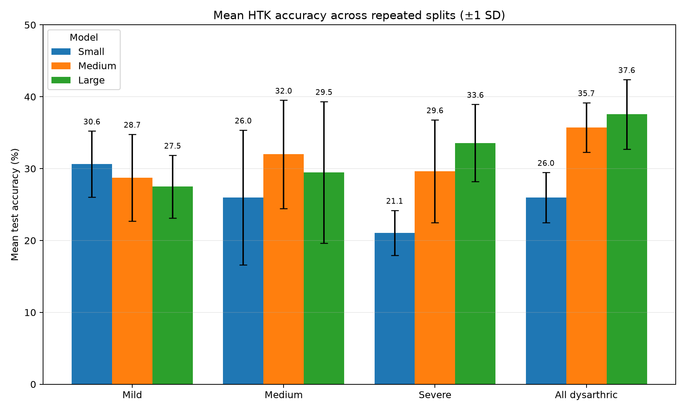

# TORGO speech recognition with HTK

This project trains whole-word GMM-HMM speech recognizers for dysarthric and control speech in the TORGO dataset. It supports one configurable experiment, a speaker-group/model-size matrix, and repeated runs with averaged results and plots.

## Requirements

- Python 3.10 or newer
- TORGO dysarthric-speaker data
- HTK 3.4.x: `HCopy`, `HCompV`, `HERest`, `HHEd`, `HParse`, `HVite`, and `HResults`

TORGO and HTK have separate licenses and are ignored by Git. Each user must obtain them from their official sources.

## Setup

Clone the repository, then create the Python environment:

```bash
git clone <repository-url>
cd <repository-directory>
python3 -m venv .venv
source .venv/bin/activate
python -m pip install -r requirements.txt
```

Place the TORGO archives under `data/`. See [`data/README.md`](data/README.md) for the expected structure. The code searches recursively, so nested archive folders are supported:

```text
data/F/F01/Session1/...
data/M/M01/Session1/...
data/FC/FC01/Session1/...
data/MC/MC01/Session1/...
```

`F` and `M` contain dysarthric speakers. `FC` and `MC` contain female and male control speakers. The control archives are optional unless a control or combined experiment is selected.

Place the licensed HTK executables in `tools/htk/bin/`, add them to `PATH`, or set:

```bash
export HTK_BIN=/absolute/path/to/htk/bin
```

Check the installation:

```bash
make check
```

TORGO recordings, HTK, virtual environments, features, trained models, and
results are intentionally excluded from Git.

## Run

For an interactive menu, run:

```bash
make start
```

The menu asks for the speaker group and number of runs. One run produces a normal model comparison; two or more runs use different deterministic splits and report averages.

The same choices can be supplied directly:

```bash
python run.py --group mild --runs 1
python run.py --group moderate --runs 10 --resume
python run.py --group control --runs 5
python run.py --group combined --runs 5
python run.py --group mild severe --runs 5
```

Train separate models on mild, moderate, severe, and all dysarthric speakers, then evaluate every model only on controls:

```bash
python run.py --group mild moderate severe all --test-group control --runs 10
```

For this cross-group mode, vocabulary is restricted to words present in both the training group and controls. Training and validation contain only dysarthric recordings; the held-out test set contains only control recordings.

All three model sizes run by default. Select model sizes when needed:

```bash
python run.py --group severe --runs 3 --models medium large
```

Launcher results are kept in a directory named for the selection, for example:

```text
results/experiments/mild__small-medium-large__10-runs/
```

This prevents one speaker group or run count from overwriting another.

Existing results are never replaced automatically. Repeating the same command creates a timestamped output directory. Resume mode reuses matching runs and preserves incompatible or incomplete runs under timestamped names. Previous standalone `make all` outputs are moved to:

```text
results/history/run_<timestamp>/
```

Run the experiment configured in [`config/experiment.json`](config/experiment.json):

```bash
make all
```

Run the default dysarthria-severity and model-size matrix once:

```bash
make matrix
```

Run the complete matrix ten times with different deterministic splits and average the results:

```bash
make matrix-10
```

Long runs can be resumed safely. A saved run is reused only when its configuration matches the current configuration:

```bash
make matrix-resume
make matrix-10-resume
```

Run a subset directly:

```bash
.venv/bin/python3 scripts/run_experiment_matrix.py \
  --groups mild severe \
  --models small large
```

Use `make help` to list the available commands.

## Experiments

The speaker groups are configured in [`config/experiment.json`](config/experiment.json):

| Matrix name | Speakers |
| --- | --- |
| `mild` | F04, M03 |
| `medium` | F03, M05 |
| `severe` | F01, M01, M02, M04 |
| `all` | All dysarthric speakers above |
| `control` | Every installed FC and MC speaker |
| `combined` | Every installed dysarthric and control speaker |

`medium` is the matrix label for the moderate group. The default split is speaker-dependent: each speaker contributes different utterances to training, validation, and test. No recording is shared across splits. The default `make matrix` command runs the four dysarthric groups; use `python run.py --group control` or `python run.py --group combined` for control experiments.

The model matrix is configured in [`config/experiment_matrix.json`](config/experiment_matrix.json):

| Model | Total states | Emitting states | Maximum mixtures |
| --- | ---: | ---: | ---: |
| `small` | 5 | 3 | 3 |
| `medium` | 7 | 5 | 5 |
| `large` | 9 | 7 | 8 |

All model sizes use the same number of training iterations at each stage. Validation accuracy selects the mixture checkpoint; test data is evaluated once with that checkpoint.

The pipeline:

1. Finds TORGO recordings and prompts.
2. Selects well-covered monosyllabic words.
3. Creates deterministic train, validation, and test splits.
4. Reads the selected WAV files directly from `data/`.
5. Extracts 39-dimensional `MFCC_0_D_A` features with HTK.
6. Trains left-to-right whole-word HMMs.
7. Selects the mixture count on validation data.
8. Evaluates the selected model on test data and creates plots.

Vocabulary is selected separately for each speaker group because recording coverage differs. Compare model sizes within a group first; cross-group scores can involve different vocabularies.

## Results

The repository includes the compact report from a completed ten-run experiment:

- [`aggregate.csv`](results/repeated_experiment_matrix/aggregate.csv) contains
  averaged metrics for every speaker-group/model-size combination.
- [`all_runs.csv`](results/repeated_experiment_matrix/all_runs.csv) contains all
  120 individual model results.
- [`results/repeated_experiment_matrix/plots`](results/repeated_experiment_matrix/plots)
  contains the generated comparison plots.



New runs write their complete local output under `results/`.

The one-pass matrix writes:

```text
results/experiment_matrix/summary.csv
results/experiment_matrix/plots/
results/experiment_matrix/runs/<group>/<model>/
```

The ten-repeat matrix writes:

```text
results/repeated_experiment_matrix/all_runs.csv
results/repeated_experiment_matrix/aggregate.csv
results/repeated_experiment_matrix/plots/
results/repeated_experiment_matrix/repetitions/repeat_<number>/
```

Each local archived run contains its configuration, selected model, validation metrics, test metrics, predictions, confusion matrix, and logs. These large intermediate archives remain ignored by Git. `aggregate.csv` includes mean accuracy, sample standard deviation, minimum, maximum, macro-word accuracy, and selected mixture count.

## Configuration

Edit [`config/experiment.json`](config/experiment.json) to change the dataset path, speakers, vocabulary size, split ratios, seed, audio limits, or the single-run model. Edit [`config/experiment_matrix.json`](config/experiment_matrix.json) to change matrix severities or model sizes.

Useful commands:

```bash
make prepare          # build metadata, splits, and features without training
make matrix-plots     # rebuild one-pass matrix plots
make repeated-plots   # rebuild repeated-run plots
make test             # run unit tests
make clean-generated  # remove features, models, metadata, and all results
```

`make clean-generated` never removes the TORGO files under `data/`, but it explicitly removes all saved experiment results. Use it only when you intend to clear the history.

## Project layout

```text
config/        experiment and MFCC settings
scripts/       dataset, training, evaluation, and plotting commands
tests/         repository-only unit tests
tools/htk/     local HTK installation, ignored by Git
data/          the only WAV source, ignored by Git
features/mfc/  generated HTK feature files
results/       generated metrics, logs, models, and plots
```

The recognizer is designed for a restricted isolated-word vocabulary. Its scores should not be interpreted as general speech-recognition performance or speaker-independent generalization.

## Licensing

TORGO and HTK are not included and remain subject to their respective terms.
No license has been assigned to this repository's original source code; add a
project license before inviting reuse or contributions.
