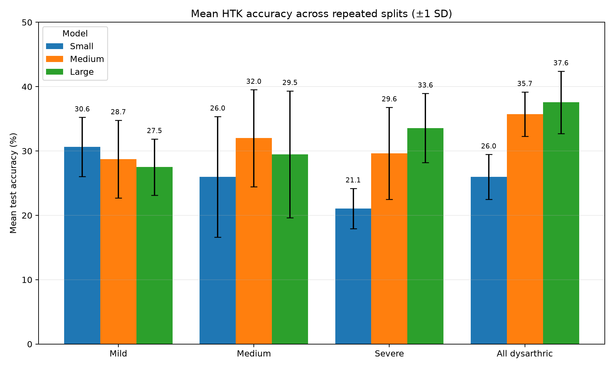

# Ten-run experiment results

These results compare three whole-word GMM-HMM sizes across mild, medium,
severe, and combined dysarthric speaker groups. Each configuration was run ten
times using deterministic seeds 1337 through 1346.

The train, validation, and test sets contain different utterances from the same
speakers. Vocabulary is selected independently for each severity group based on
available recording coverage, so comparisons between model sizes within a
group are the most direct.

## Files

- `aggregate.csv`: mean, sample standard deviation, range, macro-word accuracy,
  and selected mixture count for each group and model size.
- `all_runs.csv`: metrics for all 120 trained models.
- `plots/`: charts generated from the two CSV files.

Intermediate HTK checkpoints, logs, audio, features, and transcripts are not
included. They are unnecessary for reviewing the reported metrics and may
contain licensed TORGO-derived data or machine-specific paths.

## Mean test accuracy

| Speaker group | Small | Medium | Large |
| --- | ---: | ---: | ---: |
| Mild | 30.63% | 28.75% | 27.50% |
| Medium | 26.00% | 32.00% | 29.50% |
| Severe | 21.07% | 29.64% | 33.57% |
| All dysarthric | 25.98% | 35.73% | 37.56% |

